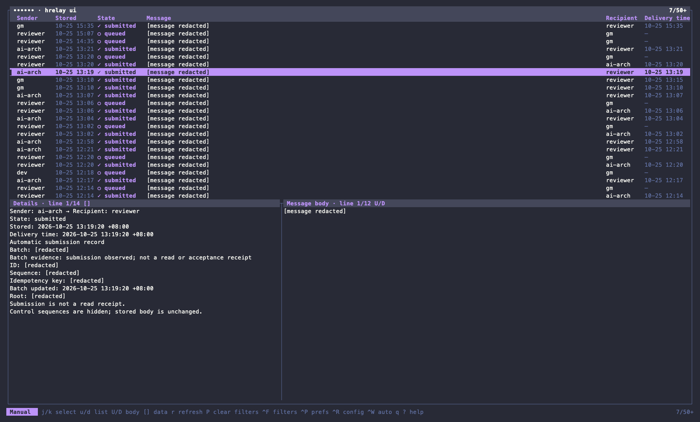
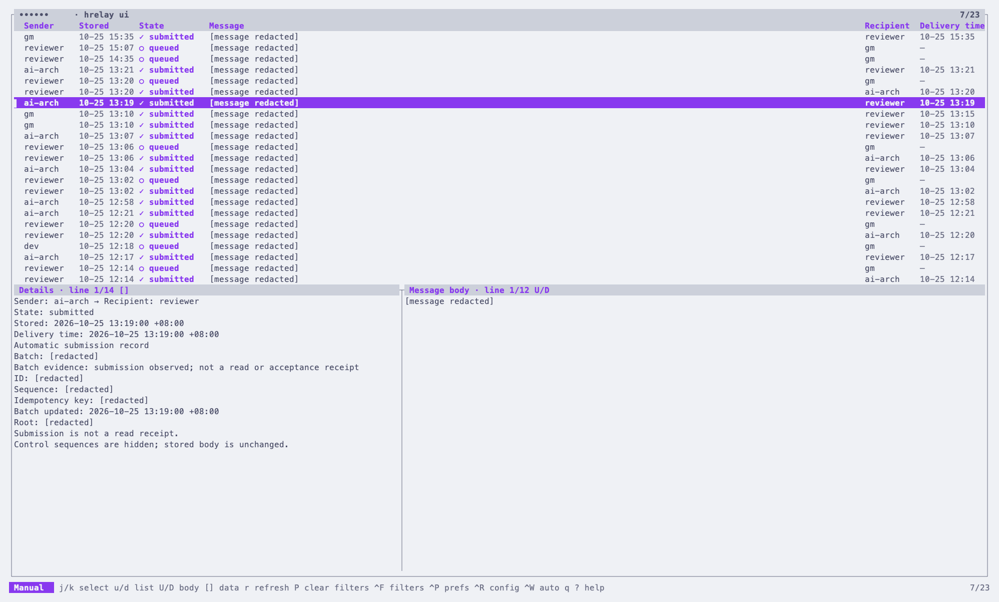
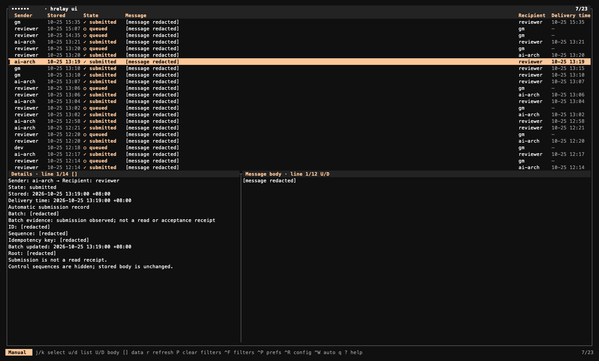

# Herdr Async Message Relay

**English** | [繁體中文](README.zh-TW.md)

Durable async messaging for [Herdr](https://herdr.dev) agents, with a terminal UI for message history.

**Queue now. Deliver when ready. Keep agents moving.**

`hrelay` stores a message in SQLite and returns without waiting for its recipient. A separate worker delivers it when that role is ready, so one busy agent does not block the others.

## Features

- **Durable, nonblocking messaging:** acceptance follows a committed SQLite transaction; dispatch skips busy roles and preserves per-role FIFO.
- **Stable role routing:** address `dev → gm`, not a temporary pane ID. Queued messages follow the role to its replacement pane.
- **Bounded batching and safe retries:** up to three messages per batch by default, original bodies preserved, idempotency keys and conservative uncertainty recovery.
- **Local transport:** private Unix socket and SQLite; no TCP listener or external database.
- **Interactive history:** browse, filter, inspect and refresh messages with `hrelay ui`; choose a language and theme in Preferences.

## Message history UI

Available in **v0.5.0**. Browse history and full message bodies without repeatedly running inspection commands:



*Image rendered from a live `hrelay ui` terminal capture. Message contents, local paths and internal identifiers are redacted; the layout and colors are retained.*

- Filter by sender, recipient and state with `Ctrl+F`.
- Browse the list, metadata and full body independently; use manual refresh or one-second automatic refresh.
- Open `Ctrl+P` to save **English / Traditional Chinese** and a theme: Terminal, Catppuccin Latte, Dracula, Rosé Pine or Vesper.
- Press `?` for shortcuts. The layout adapts to narrow terminals; `q` exits the main UI without stopping the worker.

From a Herdr pane, select your team root and start its relay once if it is not already running:

```sh
TEAM=/absolute/path/to/team
hrelay --root "$TEAM" server on
hrelay --root "$TEAM" ui
```

For a configured environment with `DELIVER_ROOT`, just run `hrelay ui`. The UI does not start or upgrade workers, send messages or resolve uncertain batches. **Unreleased defaults:** the UI starts with one-second auto refresh, and missing Claude interception policy defaults **off**, preserving explicit saved policies. Ctrl+P uses a global label scoped to this relay root and two muted hints; `?` groups shortcuts into Browsing, Filters, Settings, and Other. **Published v0.6.0 behavior:** Ctrl+P can explicitly save a team-wide, default-on Claude question interception policy; scoped Hooks keep recording question times when interception is off. This changes worker behavior, not queue records or local theme settings. Both UI and worker need v0.6.0 for team settings. In published v0.6.0, missing team policy defaults on; when interception is enabled, uninitialized Claude roles defer notifications, so review migration before upgrading. See [setup, migration and limitations](docs/claude-question-guard.md). CLI and worker must both be v0.5.0-compatible; a plugin update does not replace an already-running worker.

v0.6.0 also adds pointer-targeted wheel scrolling, pinned muted metadata notices, accented values, and `gg` / `G` jumps to the first / last currently loaded message. See [v0.6.0 changes and upgrade cautions](docs/releases/v0.6.0.md) and [UI controls and preferences](docs/ui.md). For scripts, JSON inspection, first-time service setup, CLI language flags or recovery, see the [CLI operations and advanced reference](docs/cli-reference.md).

## UI themes

Five built-in themes are available:

| Theme | Appearance |
| --- | --- |
| **Terminal** (default) | Adapts to the terminal's light/dark background. |
| **Catppuccin Latte** | Light background with purple accents. |
| **Dracula** | Dark background with purple accents. |
| **Rosé Pine** | Muted dark tones with soft rose/purple accents. |
| **Vesper** | Near-black background with warm peach accents. |

Press `Ctrl+P`, select **Theme** with `↑` / `↓`, choose with `←` / `→`, then press `Enter` to save and apply. `Esc` cancels. Themes affect the UI only, not your terminal's global color settings.

The previews below use the same redacted capture data, rendered by the v0.5.0 UI. Message contents, local paths and internal identifiers remain hidden. Dark-theme previews use a matching terminal background; the actual canvas can vary with your terminal settings.

### Catppuccin Latte



### Dracula


### Vesper



## Installation

Supports **macOS and Linux, arm64 / amd64**, with **Herdr 0.9.3+**. Install the plugin in Herdr:

```sh
herdr plugin install avery20024/herdr-async-message-relay
hrelay version
```

The installer downloads the matching precompiled binary and verifies its checksum and version. It also installs the stable command at `~/.local/bin/hrelay`; include that directory in PATH **before launching agents**, or use the absolute path reported by the installer. No Go, Python or sqlite3 CLI is required.

### Dependencies

You need Herdr, Git, `curl`, CA certificates, `sh`, `tar`, `awk`, `mktemp` and either `sha256sum` or `shasum`. macOS already includes the Unix utilities and `shasum`; Debian/Ubuntu provides the remaining tools through the packages below. These are installation examples, not commands run by the plugin.

**macOS — with [Homebrew](https://brew.sh) already installed:**

```sh
brew install git curl herdr
```

**Linux — Debian / Ubuntu:**

```sh
sudo apt-get update && sudo apt-get install -y git curl ca-certificates tar gawk coreutils
curl -fsSL https://herdr.dev/install.sh | sh
```

For other distributions, install equivalent packages and follow [Herdr's installation guide](https://herdr.dev/docs/install/). Managed background services additionally need a working **systemd user session / DBus** on Linux or **GUI launchd domain** on macOS; headless environments can use [foreground mode](docs/cli-reference.md#foreground-mode).

**Windows — Linux prerequisites through WSL, not native Windows support:**

This plugin has no native Windows binary. To prepare a Linux environment, run in an administrator PowerShell:

```powershell
wsl --install -d Ubuntu
```

Restart if requested and finish Ubuntu's first-run account setup, then run the **Linux commands above inside Ubuntu**. Herdr, the agents and relay must all run in that same Linux environment; a Windows-native Herdr session is not interchangeable with a WSL session. This WSL route has not been validated end to end. See [Microsoft's WSL guide](https://learn.microsoft.com/en-us/windows/wsl/install).

### Other installation options

- Pin or roll back with `herdr plugin install avery20024/herdr-async-message-relay --ref v0.6.0`. Normal installs can omit `--ref`; updates follow the ref recorded at installation.
- Download a platform archive from [Releases](https://github.com/avery20024/herdr-async-message-relay/releases), verify `checksums.txt` and extract it. Keep the included license and third-party notices.
- For checkout installation, PATH repair, upgrade behavior and checksum boundaries, see [installation details](docs/cli-reference.md#installation-details).

## Agent integration

Supply the canonical team root and actual sender in each agent's launch environment:

```sh
export DELIVER_ROOT=/absolute/path/to/team
export HERDR_RELAY_FROM=dev
hrelay send gm 'Task 123 is ready. Please inspect the evidence.'
```

**Unreleased role discovery:** the worker starts with `herdr agent list`, resolves each agent's absolute `foreground_cwd` through symlinks, and uses its basename as the role only when the resulting directory is strictly inside this relay's root. Any intermediate directory names/languages are allowed, such as `agents/reviewer` or `開発/担当A`. There is no `cwd` fallback or role-directory ranking. Missing/invalid foreground paths and ambiguous roles are not delivered. A valid role name can be queued while its seat is offline; names start with a Unicode letter, followed by Unicode letters/marks/digits, `_` or `-`, up to 64 UTF-8 bytes. Keep the foreground directory stable: entering a child directory changes the derived role. This routing change is not included in the published v0.6.0 binary and does not initialize Claude question observations. Setup and SOP integration: [agent guide](docs/agent-usage.md), optional [skill](skills/hrelay/SKILL.md), and [CLI reference](docs/cli-reference.md).

**Acceptance is not a read receipt.** `accepted: true` means stored, not delivered, read or approved. Preserve the returned message ID / idempotency key, and never blindly resend with a new key. If a submission cannot be observed, the worker retries the same messages in FIFO order after a short backoff, up to `DELIVER_MAX_ATTEMPTS`; delivery is therefore **at least once**, and the envelope keeps each message ID so the receiver can recognise a repeat. See [recovery and delivery semantics](docs/cli-reference.md#recovery-and-delivery-semantics).

## Documentation

- [UI controls, themes, preferences and limitations](docs/ui.md)
- [CLI operations, inspection, services, configuration, recovery and development](docs/cli-reference.md)
- [Agent setup and SOP integration](docs/agent-usage.md)
- [Experimental Claude question guard](docs/claude-question-guard.md) — scoped Hooks and v0.6.0 team-policy migration; not a guarantee against every race

Queue history can contain full messages and sensitive paths. Inspect and redact screenshots or exports before sharing; the local OS account is the trust boundary. See [security and privacy](docs/cli-reference.md#security-and-privacy).

## License

[MIT](LICENSE). Release archives include `THIRD_PARTY_NOTICES.txt` for the Go runtime and linked dependencies.
