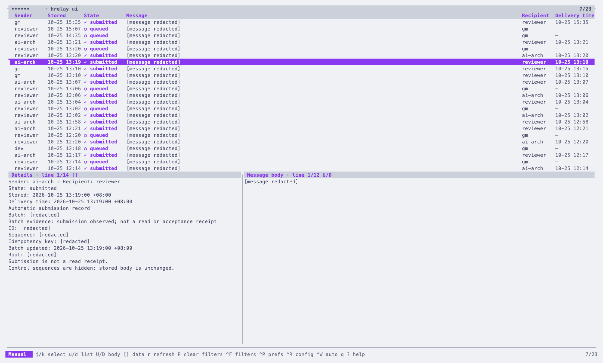
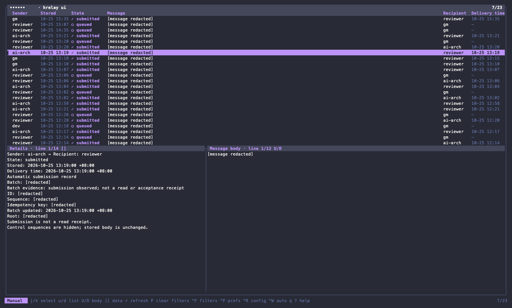
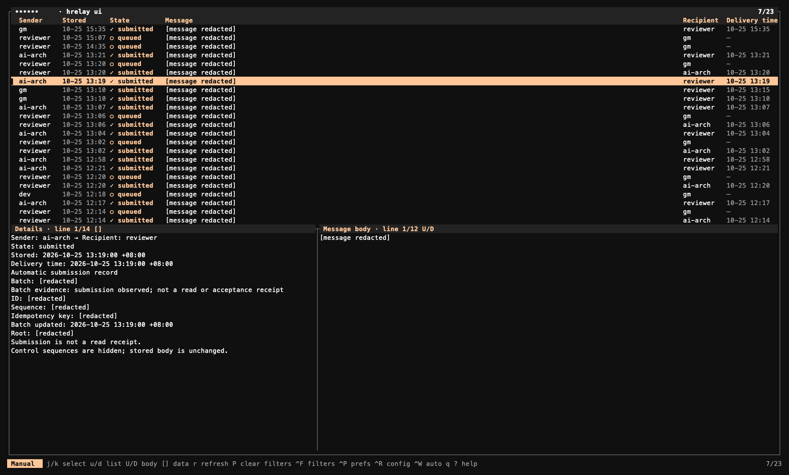

# Herdr Async Message Relay

**English** | [繁體中文](README.zh-TW.md)

Durable async messaging for [Herdr](https://herdr.dev) agents, with a terminal UI for message history.

**Queue now. Deliver when ready. Keep agents moving.**

`hrelay` stores a message in SQLite and returns without waiting for its recipient. A separate worker delivers it when that role is ready, so one busy agent does not block the others.

## Features

- **Durable, nonblocking messaging:** acceptance follows a committed SQLite transaction; dispatch skips busy roles and preserves per-role FIFO.
- **Stable role routing:** address `dev → gm`, not a temporary pane ID. Queued messages follow the role to its replacement pane.
- **Bounded batching and safe retries:** up to three messages per batch by default, original bodies preserved, idempotency keys and conservative uncertainty recovery.
- **Local transport:** private Unix socket and SQLite; no TCP listener or external database.
- **Interactive history:** browse, filter, inspect and refresh messages with `hrelay ui`; choose a language and theme in Preferences.

## Message history UI

Available in **v0.5.0**. Browse history and full message bodies without repeatedly running inspection commands:


*Image rendered from a live `hrelay ui` terminal capture. Message contents, local paths and internal identifiers are redacted; the layout and colors are retained.*

- Filter by sender, recipient and state with `Ctrl+F`.
- Browse the list, metadata and full body independently; use manual refresh or one-second automatic refresh.
- Open `Ctrl+P` to save **English / Traditional Chinese** and a theme: Terminal, Catppuccin Latte, Dracula, Rosé Pine or Vesper.
- Press `?` for shortcuts. The layout adapts to narrow terminals; `q` exits the main UI without stopping the worker.

From a Herdr pane, select your team root and start its relay once if it is not already running:

```sh
TEAM=/absolute/path/to/team
hrelay --root "$TEAM" server on
hrelay --root "$TEAM" ui
```

For a configured environment with `DELIVER_ROOT`, just run `hrelay ui` from any directory; see [Team root and instances](#team-root-and-instances). The UI does not start or upgrade workers, send messages or resolve uncertain batches. **Defaults:** the UI starts with one-second auto refresh, and missing Claude interception policy defaults **off**, preserving explicit saved policies. The v0.8.2 UI restores the experimental interception switch and its two muted hints in Ctrl+P (hidden in v0.8.1); opening the menu preserves the saved policy, and only Enter on a changed draft writes it; `?` groups shortcuts into Browsing, Filters, Settings, and Other. Scoped Hooks keep recording question times when interception is off. Restart the worker on the matching version to use the current routing and missing-policy default; publishing or updating the CLI/UI does not replace a running worker. Earlier releases (for example v0.6.0) default missing policy to on; existing explicit on/off settings remain unchanged on upgrade. **v0.8.2 observation gating:** missing/unusable question observations no longer add a delivery block; only a matching observed PreToolUse without its PostToolUse blocks. The new `claude-run` launch wrapper records each harness generation so a same-session restart excludes old pending questions and delayed Hooks. v0.8.1 retains the earlier strict ready-state requirement. Missing events can miss protection; this is an accepted fail-open trade-off, not guaranteed interception. See [setup, migration and limitations](docs/claude-question-guard.md). CLI and worker must both be v0.5.0-compatible; a plugin update does not replace an already-running worker.

Per-release changes, routing risks and upgrade cautions are in [docs/releases](docs/releases/). v0.6.0 added pointer-targeted wheel scrolling, pinned muted metadata notices, accented values, and `gg` / `G` jumps to the first / last currently loaded message. See [v0.6.0 changes and upgrade cautions](docs/releases/v0.6.0.md) and [UI controls and preferences](docs/ui.md). For scripts, JSON inspection, first-time service setup, CLI language flags or recovery, see the [CLI operations and advanced reference](docs/cli-reference.md).

## Installation

Supports **macOS and Linux, arm64 / amd64**, with **Herdr 0.9.3+**. Install the plugin in Herdr:

```sh
herdr plugin install avery20024/herdr-async-message-relay
hrelay version
```

The installer downloads the matching precompiled binary and verifies its checksum and version. It also installs the stable command at `~/.local/bin/hrelay`; include that directory in PATH **before launching agents**, or use the absolute path reported by the installer. No Go, Python or sqlite3 CLI is required.

### Dependencies

You need Herdr, Git, `curl`, CA certificates, `sh`, `tar`, `awk`, `mktemp` and either `sha256sum` or `shasum`. macOS already includes the Unix utilities and `shasum`; Debian/Ubuntu provides the remaining tools through the packages below. These are installation examples, not commands run by the plugin.

**macOS — with [Homebrew](https://brew.sh) already installed:**

```sh
brew install git curl herdr
```

**Linux — Debian / Ubuntu:**

```sh
sudo apt-get update && sudo apt-get install -y git curl ca-certificates tar gawk coreutils
curl -fsSL https://herdr.dev/install.sh | sh
```

For other distributions, install equivalent packages and follow [Herdr's installation guide](https://herdr.dev/docs/install/). Managed background services additionally need a working **systemd user session / DBus** on Linux or **GUI launchd domain** on macOS; headless environments can use [foreground mode](docs/cli-reference.md#foreground-mode).

**Windows — Linux prerequisites through WSL, not native Windows support:**

This plugin has no native Windows binary. To prepare a Linux environment, run in an administrator PowerShell:

```powershell
wsl --install -d Ubuntu
```

Restart if requested and finish Ubuntu's first-run account setup, then run the **Linux commands above inside Ubuntu**. Herdr, the agents and relay must all run in that same Linux environment; a Windows-native Herdr session is not interchangeable with a WSL session. This WSL route has not been validated end to end. See [Microsoft's WSL guide](https://learn.microsoft.com/en-us/windows/wsl/install).

### Other installation options

- Pin or roll back with `herdr plugin install avery20024/herdr-async-message-relay --ref <tag>`. Normal installs can omit `--ref`; updates follow the ref recorded at installation.
- Download a platform archive from [Releases](https://github.com/avery20024/herdr-async-message-relay/releases), verify `checksums.txt` and extract it. Keep the included license and third-party notices.
- For checkout installation, PATH repair, upgrade behavior and checksum boundaries, see [installation details](docs/cli-reference.md#installation-details).

## Team root and instances

One team root is one relay instance. The root decides which queue, socket and background service a command talks to, so every command, including `hrelay ui`, must resolve to the same root as the worker.

There are two ways to tell hrelay the root: set the `DELIVER_ROOT` variable, or place a `.hrelay` marker file in the root so commands run anywhere below it are intercepted from the outside. The variable always wins over the marker.

**How the root is chosen** (first match wins):

1. `--root PATH` (explicit command-line override)
2. `DELIVER_ROOT` (variable; takes priority over the marker)
3. the nearest parent directory, starting at the current one, that contains a `.hrelay` marker created by `hrelay init`
4. otherwise an error; hrelay never uses the current directory by itself

**From root to instance.** The root is made absolute and symlinks are resolved. The state directory is `$XDG_STATE_HOME/herdr-deliver/<first 16 hex digits of sha256(root)>` (`~/.local/state` when unset) and holds the queue and `deliver.sock`; `DELIVER_STATE_DIR` overrides it. The managed launchd/systemd service is identified by a hash of the root and state directory. Different roots therefore have separate queues, sockets and services, so several projects can run side by side on one machine, while two paths that resolve to the same directory share one instance. Reaching the same project through a different root, such as a role subdirectory, selects a different and empty instance, and role discovery will not find the seats.

**Typical setups**

- AI teams: the launcher sets `DELIVER_ROOT` and `HERDR_RELAY_FROM` in each seat's environment, so seats stay in their own directories and still reach the team relay. With `DELIVER_ROOT` set, `hrelay ui` and `hrelay send` work from any directory.
- Individual projects: run `hrelay init` once in the project root. It creates the marker and prints `export` lines for the environment; afterwards `hrelay server on`, `hrelay ui` and `hrelay send` work from any directory below that root without extra settings.
- Verification: `hrelay status` prints `project_root`; confirm it is the directory you expect before sending. `hrelay ps` lists every instance on the machine; `hrelay stop|start|rm ID` manage them (see [instance management](docs/cli-reference.md#manage-instances-by-id)).

The `.hrelay` marker contains only a schema version, never a path, so copying it elsewhere does not point at the original root. Only a regular file with that name counts; directories and symlinks are ignored, and directory names are never used to guess a root.

## Agent integration

Supply the canonical team root and actual sender in each agent's launch environment:

```sh
export DELIVER_ROOT=/absolute/path/to/team
export HERDR_RELAY_FROM=dev
hrelay send gm 'Task 123 is ready. Please inspect the evidence.'
```

**Role discovery:** foreground directories must resolve through symlinks to existing directories strictly inside this relay's root. Routing prefers a valid **tab label**, then a valid Herdr agent name, then the physical foreground directory basename; there is no shell `cwd` fallback or fixed directory language. The worker joins `herdr agent list` to `herdr tab list` by `tab_id`, removing only Herdr's leading `[n] ` display number. Missing/invalid topology or ambiguous complete addresses defer delivery. Names start with a Unicode letter, followed by letters/marks/digits, `_` or `-`, up to 64 UTF-8 bytes; comparison is exact, without Unicode normalization. Valid offline addresses can be queued without creating per-address directories. **Tab-label routing requires the v0.8.2 worker; v0.8.1 only supports agent-name/directory routing.** Updating a CLI or this README does not replace a running worker. Setup: [agent guide](docs/agent-usage.md), optional [skill](skills/hrelay/SKILL.md), [CLI reference](docs/cli-reference.md).

**Multiple named seats:** tabs such as `dispatch-front-login` and `dispatch-back-sort` may share one foreground directory while receiving independent messages. Set each sender's `HERDR_RELAY_FROM` to its complete address and send to that address, not a shared role type. Keep one receiving agent per tab. Two agents claiming the same complete address remain ambiguous even if only one is idle; no broadcast or arbitrary choice is made. Tab/agent names are routing identities, not cosmetic labels. A valid tab label overrides the agent/directory name; overridden names are not aliases. Legacy Herdr responses without `tab_id` retain agent-name/directory fallback; if `tab_id` is present but the tab query fails or its tab disappears between snapshots, discovery fails closed and retries on the next scan.

**Acceptance is not a read receipt.** `accepted: true` means stored, not delivered, read or approved. Preserve the returned message ID / idempotency key, and never blindly resend with a new key. If a submission cannot be observed, the worker retries the same messages in FIFO order after a short backoff, up to `DELIVER_MAX_ATTEMPTS`; delivery is therefore **at least once**, and the envelope keeps each message ID so the receiver can recognise a repeat. See [recovery and delivery semantics](docs/cli-reference.md#recovery-and-delivery-semantics).

## UI themes

Five built-in themes are available:

| Theme | Appearance |
| --- | --- |
| **Terminal** (default) | Adapts to the terminal's light/dark background. |
| **Catppuccin Latte** | Light background with purple accents. |
| **Dracula** | Dark background with purple accents. |
| **Rosé Pine** | Muted dark tones with soft rose/purple accents. |
| **Vesper** | Near-black background with warm peach accents. |

Press `Ctrl+P`, select **Theme** with `↑` / `↓`, choose with `←` / `→`, then press `Enter` to save and apply. `Esc` cancels. Themes affect the UI only, not your terminal's global color settings.

The previews below use the same redacted capture data, rendered by the v0.5.0 UI. Message contents, local paths and internal identifiers remain hidden. Dark-theme previews use a matching terminal background; the actual canvas can vary with your terminal settings.

### Catppuccin Latte



### Dracula



### Vesper



## Documentation

- [UI controls, themes, preferences and limitations](docs/ui.md)
- [CLI operations, inspection, services, configuration, recovery and development](docs/cli-reference.md)
- [Agent setup and SOP integration](docs/agent-usage.md)
- [Experimental Claude question guard](docs/claude-question-guard.md) — scoped Hooks and team-policy migration; not a guarantee against every race

Queue history can contain full messages and sensitive paths. Inspect and redact screenshots or exports before sharing; the local OS account is the trust boundary. See [security and privacy](docs/cli-reference.md#security-and-privacy).

## License

[MIT](LICENSE). Release archives include `THIRD_PARTY_NOTICES.txt` for the Go runtime and linked dependencies.
