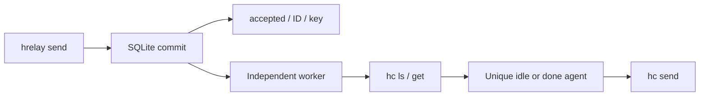

# herdr-core backend / core 投遞後端（未發布／Unreleased）

## Scope and version / 範圍與版本

This describes **development source**, based on the hc **0.1.21** CLI contract ([source c84d6e7](https://github.com/herdrdev/herdr-core/tree/c84d6e76156a6c2aac1da20efbe800f10acfe897)). VERSION is unchanged in this development work: a local `make build` still prints v0.8.2, so that string alone cannot identify this uncommitted source feature. Released **hrelay v0.8.2 does not support core**. Building this checkout does not update an installed CLI or a running worker. Installation, service switching and real-agent acceptance are separate operator actions. No native Windows support or herdr-app Mod is added.

本文件描述**開發版原始碼**，介面依據 hc **0.1.21**。已發布的 **hrelay v0.8.2 不支援 core**；建置 checkout 不會更新已安裝 CLI 或運行中的 worker。本次不新增原生 Windows 支援或 App Mod，也不自動安裝、切服務或接管舊佇列。

## Backend selection / 後端選擇

`HRELAY_BACKEND` accepts `auto` (default), `herdr`, or `core`:

| Context / 環境 | Result / 行為 |
| --- | --- |
| auto, no HC terminal/socket markers | Existing Herdr backend / 沿用舊後端 |
| auto, valid local HC_TERMINAL_ID plus absolute HC_TERMINAL_SOCKET | Core backend / 選 core |
| auto, incomplete HC markers, socket-only context or conflicting sockets | Error; no fallback / 拒絕，不退回舊通道 |
| explicit herdr | Operator-selected old backend / 管理員明確指定舊後端 |
| explicit core, absolute HC_SOCKET | Worker/manual context without a caller terminal / worker 或人工環境 |

If terminal markers exist in core mode, both must be valid; `HC_SOCKET`, when also present, must agree. `HC_SCOPE` alone is not a backend selector. `HC_BIN_PATH` selects the native hc executable (default `hc`); the old `HERDR_BIN_PATH` remains unchanged. The core adapter removes inherited HC variables from its subprocess environment and sets the saved `HC_SOCKET`, so a daemon never impersonates its originating terminal or silently follows another session.

core 終端標記存在時必須完整，且不得與 HC_SOCKET 衝突。HC_SCOPE 單獨不觸發分流。HC_BIN_PATH 選 hc，HERDR_BIN_PATH 仍只供舊後端。背景服務保存明確後端、hc 路徑與 socket，**不保存 HC_TERMINAL_ID／HC_SCOPE 等發送席位身份**，不靠登入時碰巧繼承的環境猜測。

## Durable queue first / 仍先入列



Before POST, the sending CLI verifies its own physical pwd and live identity through the selected backend's bounded read-only topology adapter. Core uses `HC_TERMINAL_ID` as the binding and ignores inherited Herdr pane/tab/context flags; sender hints must still agree. Lookup failure inside a core seat rejects before ensure/enqueue; an explicitly authorized outside-seat operator path remains available. Topology discovery may inspect other terminals, but recipient existence/readiness is not an enqueue condition. See [sender verification](sender-identity.md).

The enqueue API never calls hc to wait for the recipient. A configured healthy relay can accept an offline address without a per-role directory. The native command and existing example wrapper keep their interface and idempotency behavior. A direct-`hc send` team wrapper still bypasses this relay and must be explicitly changed later if the team adopts the updated hrelay; this repository does not edit external team scripts or SOPs.

發送 CLI 先以選定 backend 唯讀核對 caller 身分；core 綁定 HC_TERMINAL_ID，不混入舊 Herdr pane／tab。席位內查詢失敗先拒送；人工離線入口仍須明確授權與 --from，不以環境值代替。拓樸探索可能讀取其他終端，但不以收件在線／idle 作入列條件。其後取得 SQLite 持久入列回應，不等待收件席位。離線合法地址可入列，不要求建立角色目錄。原生指令與倉庫的 hrelay 包裝範例介面不變，冪等 key 仍有效；外部若已自行分流成直接 hc send，**不會因這次原始碼變更自動改走 hrelay**，需另外調整。

## Isolation and compatibility / 新舊隔離

- **Herdr:** keep the exact legacy state path, root binding, schema-1 service record and registry location. No database migration or healthy worker replacement occurs.
- **Core default state:** `${XDG_STATE_HOME:-$HOME/.local/state}/herdr-deliver/core-<hash>/`, where hash is the first 16 hex digits of SHA-256 of `canonical_root + NUL + core + NUL + core_socket`.
- **Core registry:** a `core/` child of the normal service registry (including a custom HERDR_RELAY_SERVICE_HOME). Schema-2 records live below that child, where the old tag reader's one-level glob cannot encounter them. `ps`, ID commands and restore operate within the selected backend registry. They are not a combined inventory of both backends.
- The core state has a private `backend.json` binding for root/backend/socket, created under the daemon lock before SQLite. An unbound state containing a database is refused by core; a legacy process using this development version refuses a core-bound state. Missing/invalid/conflicting bindings are not repaired automatically.
- Core OS job IDs also include backend/socket, not just root/state. Core service registration checks both registries for conflicting state ownership, even for a paused/failed registration that has no database yet. Legacy Ensure does not scan the core registry, so a broken core record cannot block the old backend. Default independent paths are strongly preferred; this is not a distributed transaction protecting simultaneously misconfigured manual state overrides.
- `DELIVER_STATE_DIR` remains an override, but cannot authorize cross-backend or cross-socket takeover. Explicitly reusing an old queue is an error, not migration. A core health probe additionally verifies project/backend/socket; missing backend in an old response is treated as Herdr, never core.

舊 Herdr 的 state、registry 與 schema 1 保留；core 的 state 依 root＋socket 分開，registry 另放一層，避免目前 tag 版的 reader 讀到不認識的新 schema。兩邊可同時使用同一專案 root，但**角色郵箱不是跨後端橋接**，同名 gm 各自屬於不同通道。後端切換不搬訊息；舊 queued／uncertain 留在原處，需另行核對與授權安排。

從舊 Herdr／core 各自執行 `hrelay ps --json` 會看到該後端 registry；不能把其中一邊的清單當作全機完整席位或訊息盤點。明確選擇舊後端可使用 `HRELAY_BACKEND=herdr`，但不得偽造 sender 或借此誤投舊同名角色。

Do not delete `backend.json` to bypass a binding error, share a DB between backends, or use an old binary against the new core state. An old binary cannot enforce new metadata it does not understand. The isolation guarantee assumes callers keep their intended backend state configuration.

不要刪除 backend.json 繞過錯誤、讓兩種後端共用 DB，或拿舊 binary 人工指向 core state。舊版不認識新標記，不能期待它幫忙防止這種手動誤設；預設隔離與新版綁定檢查才是正常使用路徑。

## Recipient discovery / 收件座位解析

Core discovery reads `hc ls --json` and `hc get --json -- tN`:

- Only local `tN` addresses; remote `machine/tN` entries are excluded. Run the relay on the same machine as its recipients, including when viewing it remotely through herdr-app.
- A live terminal's actual `foreground.cwd` must resolve to an existing directory **strictly inside** the relay root; no launch-CWD fallback. Directory language and layout are unrestricted.
- Effective role: valid **core terminal name**, otherwise physical foreground directory basename. App tab labels, title and `where` are not routing identities. Named seats can share directories; invalid/missing terminal names use the documented basename fallback, not a hard-coded role container.
- Complete role duplicates remain ambiguous, including busy or blocked duplicates. No broadcast or arbitrary idle-seat selection.
- Submit only idle/done agents with valid turn and process-generation metadata. Shells, missing metadata, working/blocked/error/unknown remain queued. Worker sequence fencing uses core turn, not Herdr's state_change_seq.
- Batch history's text `pane` field stores `tN@created_ms:terminal_pid:foreground_pid` for core. This is a persisted generation fence, not a CLI target; actual hc commands use only `tN`. It prevents a replacement process with a reset turn from inheriting an older process's sequence fence, without changing the SQLite schema or Herdr records.
- Recheck role, turn, process generation and readiness immediately before submission. Idle submissions also use `--if idle`. There is no atomic name/CWD/turn transaction with hc; done-state races rely on hc's default blocked-state protection. Never use force or keyboard fallback.

core 採終端 name 優先、實體前景目錄 basename 備援，不綁 A-BOMB 或任何固定語言目錄。App 分頁標籤不等於 core name；共用目錄的具名 Dispatch 必須有各自完整終端名稱。嚴格 root 邊界、重名保守拒絕與 idle／done 條件保留。缺少前景 CWD 不猜啟動目錄，缺世代資料不投遞；不能從畫面文字猜狀態。

## Bounded delivery and uncertainty / 有界投遞與不確定結果

The worker retains per-role FIFO and up to four independent dispatch tasks. A zero-exit structured send confirmation must match the pre-send turn/status and include `started`. hc's returned turn is the **pre-paste turn**, not an advanced result turn; `started=false` still confirms transport submission, not task acceptance. The ordinary next-batch turn fence waits for later observed progress. See [upstream send implementation](https://github.com/herdrdev/herdr-core/blob/c84d6e76156a6c2aac1da20efbe800f10acfe897/crates/herdr-core/src/input.rs). Discovery and submission commands are bounded (10 seconds by default); no `--wait`, `--force`, shell background fork, or direct-prompt fallback is used. A busy recipient is skipped before dispatch; one slow send does not synchronously hold the enqueue caller or another role's dispatch task. Pool saturation and discovery failures can still delay delivery: this is not a latency guarantee.

hc may wait for a person's draft longer than the command deadline. Killing or disconnecting the CLI cannot prove that the core canceled a pending submission. Therefore any submission error, timeout, invalid confirmation or interrupted dispatch is **uncertain**. **Core never retries it automatically and holds that recipient's subsequent messages until inspected and resolved.** Other recipients continue. Core limits automatic attempts to one regardless of DELIVER_MAX_ATTEMPTS; the original Herdr retry policy is unchanged.

core 送入可能等待管理員草稿。逾時／CLI 被中斷不代表 core 一定取消，所以結果不明時保留 uncertain，不自動重送，也不送同角色後續訊息。其他角色仍可繼續；必須先查收件畫面、訊息 ID 與任務記錄，再由獲授權操作者 resolve：

```sh
# Only after inspecting and confirming it was not delivered:
hrelay resolve --batch batch-ID --action retry --confirm --note 'Inspection evidence'
# Only after confirming the original submission:
hrelay resolve --batch batch-ID --action submitted --confirm --note 'Inspection evidence'
```

Acceptance is not read/task acceptance; submitted is only a transport confirmation. No exactly-once guarantee is made, and a manual retry can duplicate an earlier unobserved send.

## Operation / 操作

After an operator has installed a supporting version, from a core terminal on the agent machine:

```sh
export DELIVER_ROOT=/absolute/team
export HERDR_RELAY_FROM=actual-role
hrelay server on
hrelay server status
hrelay send --key report-v1 recipient 'Exact report body'
hrelay status
hrelay ui
```

For a manually supervised worker outside a core terminal, select the backend explicitly:

```sh
HRELAY_BACKEND=core HC_SOCKET=/absolute/core.sock \
  /absolute/development/hrelay --root /absolute/isolated/team serve
```

Do not use shell `&`. Before invoking hc, the adapter checks that the bound socket accepts a connection, so a known-unavailable core is not passed to hc for autostart. A check-to-command race remains: hc itself can autostart on some platforms if core stops immediately afterward ([upstream client behavior](https://github.com/herdrdev/herdr-core/blob/c84d6e76156a6c2aac1da20efbe800f10acfe897/crates/herdr-core/src/client.rs)); this adapter is not an atomic no-autostart protocol. Managed launchd/systemd records preserve their socket; the normal lifecycle watcher follows that core socket, not HERDR_SOCKET_PATH. Closing the App window is not the same as losing the core socket. A paused service remains paused until an explicit start. There is no App startup hook installed by this change; start/ensure the relay explicitly or through an authorized existing service setup.

Claude's existing Hook/claude-run guard was designed for Herdr pane/session identities and is **not integrated into core**. Core delivery uses reported status and hc's blocked protection only. Guard settings report this limitation and reject policy changes rather than pretending interception is enabled. Core question/permission false-idle behavior is not proven fixed by this adapter.

本次不安裝 App startup hook；受管理服務綁 core socket，關 App 視窗不等於停 core。舊 Claude Hook／claude-run 問答攔截未移植到 core，介面會揭露不支援並拒絕修改，不偽造 ready，也不宣稱解決 false-idle 問題。

## Verification limits / 驗證限制

Tests use fake hc executables, fake service-manager runners, temporary SQLite databases and private Unix sockets. No live agent, formal queue, installed binary or OS service manager is used. Real remote reconnect, raw Agent interaction, actual service-manager startup and human acceptance remain separate tests. Source compatibility with other hc versions is not asserted.
